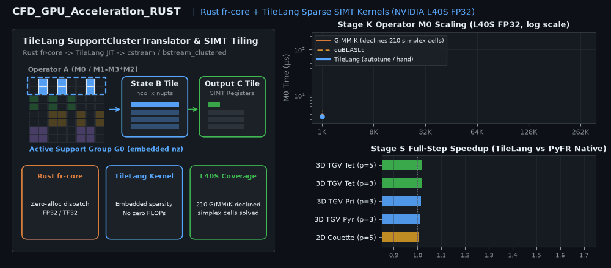
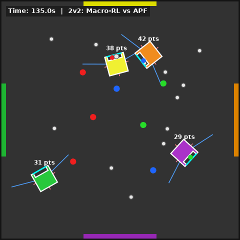
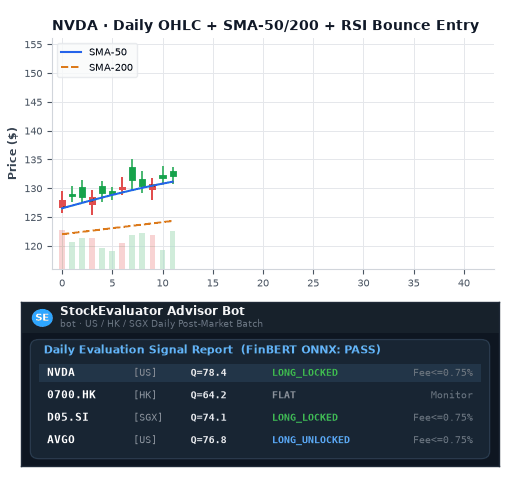
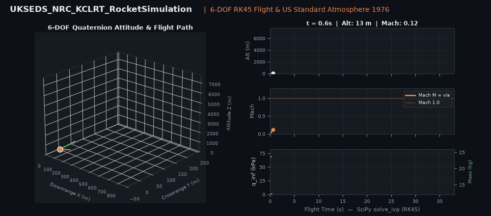

## Recent Projects 👨‍💻

### [CFD GPU Acceleration in Rust](https://github.com/Mengcer/CFD_GPU_Acceleration_RUST)&nbsp;&nbsp;&nbsp;Rust · TileLang · CUDA · High-Order Flux Reconstruction (2D Cylinder & 3D TGV)

<table>
  <tr>
    <td width="50%" valign="top">
      <h3><a href="https://github.com/Mengcer/Unibots_UK25">Unibots UK '25</a>&nbsp;&nbsp;&nbsp;Multi-Agent Macro-RL · ESP32 C++ Tree (~0.01 ms)</h3>
      
    </td>
    <td width="50%" valign="top">
      <h3><a href="https://github.com/Mengcer/StockEvaluator">StockEvaluator</a>&nbsp;&nbsp;&nbsp;23-Stock Multi-Market Quant · FinBERT ONNX · Telegram</h3>
      
    </td>
  </tr>
</table>

### [UKSEDS NRC KCLRT Rocket Simulation](https://github.com/Mengcer/UKSEDS_NRC_KCLRT_RocketSimulation)&nbsp;&nbsp;&nbsp;6-DOF RK45 · US Standard Atmosphere 1976 · Quaternion Kinematics

## Languages and Tools:

  &nbsp;
  &nbsp;
  &nbsp;
  &nbsp;
  &nbsp;
  &nbsp;
  &nbsp;
  &nbsp;
  &nbsp;
  &nbsp;
  

